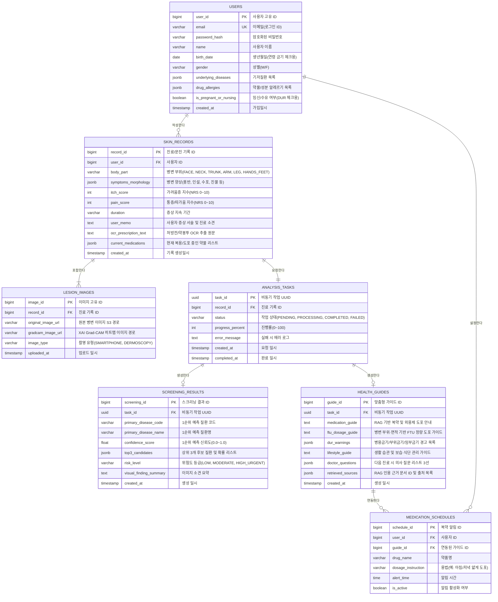

# [프로젝트] AI 기반 피부 병변 스크리닝 및 맞춤형 복약·생활 가이드 웹서비스

## 데이터베이스 ERD 및 테이블 명세서 (v1.0)

### 1. 데이터베이스 설계 개요
* **DBMS 권장 사양:** PostgreSQL 15+ (정형 데이터 및 JSONB 기반 AI 메타데이터/인용 근거 저장 용이)
* **설계 핵심 원칙:**
  1. **피부과 임상 문진 특화:** 단순 이미지 저장을 넘어 병변 부위(`body_part`), 자각 증상(`itch_score`), 피부 양상(`morphology`)을 구조화하여 외용제(스테로이드) 도포 적합성 판별의 근거로 활용한다.
  2. **비동기 파이프라인 추적:** Redis/Celery 기반의 AI 추론 및 RAG 생성 작업을 추적하기 위해 `ANALYSIS_TASKS` 테이블을 분리하여 상태를 관리한다.
  3. **설명 가능성 및 근거 추적:** AI 스크리닝의 Grad-CAM 히트맵 경로와 RAG가 참조한 식약처/학회 근거 문서 ID를 리포트 테이블에 명시적으로 기록한다.

---

### 2. ERD (Entity-Relationship Diagram)

---

### 3. 상세 테이블 명세

#### 3.1 `USERS` (사용자 및 건강 프로필)
| 컬럼명 | 데이터 타입 | 제약조건 | 설명 |
| :--- | :--- | :--- | :--- |
| `user_id` | `BIGINT` | `PK, AUTO_INCREMENT` | 사용자 고유 식별자 |
| `email` | `VARCHAR(255)` | `UNIQUE, NOT NULL` | 로그인용 이메일 주소 |
| `password_hash` | `VARCHAR(255)` | `NOT NULL` | 단방향 암호화(Bcrypt)된 비밀번호 |
| `name` | `VARCHAR(100)` | `NOT NULL` | 사용자 이름 |
| `birth_date` | `DATE` | `NOT NULL` | 생년월일 (소아/고령자 약물 금기 검증용) |
| `gender` | `VARCHAR(10)` | `NOT NULL` | 성별 (`M`, `F`) |
| `underlying_diseases` | `JSONB` | `DEFAULT '[]'` | 기저질환 배열 (예: `["당뇨", "고혈압", "간질환"]`) |
| `drug_allergies` | `JSONB` | `DEFAULT '[]'` | 알레르기 성분 배열 (예: `["페니실린", "라놀린"]`) |
| `is_pregnant_or_nursing` | `BOOLEAN` | `DEFAULT FALSE` | 임신 또는 수유 여부 (레티노이드/고강도 스테로이드 금기 체크) |
| `created_at` | `TIMESTAMP` | `DEFAULT NOW()` | 계정 생성 일시 |

#### 3.2 `SKIN_RECORDS` (피부 진료 및 문진 기록)
| 컬럼명 | 데이터 타입 | 제약조건 | 설명 |
| :--- | :--- | :--- | :--- |
| `record_id` | `BIGINT` | `PK, AUTO_INCREMENT` | 진료/문진 기록 고유 식별자 |
| `user_id` | `BIGINT` | `FK (USERS.user_id), NOT NULL` | 작성 사용자 ID |
| `body_part` | `VARCHAR(50)` | `NOT NULL` | 병변 발생 부위 (`FACE`, `SCALP`, `NECK`, `TRUNK`, `ARM`, `LEG`, `HANDS_FEET`, `GROIN`) |
| `symptoms_morphology` | `JSONB` | `NOT NULL` | 병변 형태/양상 (예: `["홍반", "인설", "진물"]`) |
| `itch_score` | `INT` | `CHECK (0 <= itch_score <= 10)` | 가려움증 강도 점수 |
| `pain_score` | `INT` | `CHECK (0 <= pain_score <= 10)` | 통증/작열감 강도 점수 |
| `duration` | `VARCHAR(50)` | `NULL` | 증상 발현 기간 (예: `"3일 이내"`, `"1개월 이상"`) |
| `user_memo` | `TEXT` | `NULL` | 사용자가 직접 입력한 증상 상세 및 의사 소견 |
| `ocr_prescription_text` | `TEXT` | `NULL` | 처방전/약봉투 이미지에서 OCR로 추출된 원본 텍스트 |
| `current_medications` | `JSONB` | `DEFAULT '[]'` | 추출/입력된 복용약 및 외용제 리스트 |
| `created_at` | `TIMESTAMP` | `DEFAULT NOW()` | 기록 생성 일시 |

#### 3.3 `LESION_IMAGES` (병변 이미지 및 XAI 히트맵)
| 컬럼명 | 데이터 타입 | 제약조건 | 설명 |
| :--- | :--- | :--- | :--- |
| `image_id` | `BIGINT` | `PK, AUTO_INCREMENT` | 이미지 고유 식별자 |
| `record_id` | `BIGINT` | `FK (SKIN_RECORDS.record_id), NOT NULL` | 연결된 진료 기록 ID |
| `original_image_url` | `VARCHAR(512)` | `NOT NULL` | 비식별화 처리 후 오브젝트 스토리지(S3)에 저장된 원본 경로 |
| `gradcam_image_url` | `VARCHAR(512)` | `NULL` | AI 모델이 집중한 부위를 시각화한 Grad-CAM 이미지 경로 |
| `image_type` | `VARCHAR(30)` | `DEFAULT 'SMARTPHONE'` | 이미지 촬영 방식 (`SMARTPHONE`, `DERMOSCOPY`) |
| `uploaded_at` | `TIMESTAMP` | `DEFAULT NOW()` | 업로드 일시 |

#### 3.4 `ANALYSIS_TASKS` (비동기 AI 파이프라인 작업 관리)
| 컬럼명 | 데이터 타입 | 제약조건 | 설명 |
| :--- | :--- | :--- | :--- |
| `task_id` | `UUID` | `PK` | 클라이언트 폴링/SSE 조회용 비동기 작업 고유 ID |
| `record_id` | `BIGINT` | `FK (SKIN_RECORDS.record_id), UNIQUE` | 분석 대상 진료 기록 ID |
| `status` | `VARCHAR(20)` | `NOT NULL, DEFAULT 'PENDING'` | 처리 상태 (`PENDING`, `PROCESSING`, `COMPLETED`, `FAILED`) |
| `progress_percent` | `INT` | `DEFAULT 0` | 진행률 (`0`: 대기, `30`: 이미지 분석 완료, `70`: RAG 검색 완료, `100`: 가이드 생성 완료) |
| `error_message` | `TEXT` | `NULL` | 작업 실패 시 디버깅용 에러 메시지 |
| `created_at` | `TIMESTAMP` | `DEFAULT NOW()` | 작업 큐 등록 일시 |
| `completed_at` | `TIMESTAMP` | `NULL` | 전체 파이프라인 완료 일시 |

#### 3.5 `SCREENING_RESULTS` (질환 스크리닝 AI 추론 결과)
| 컬럼명 | 데이터 타입 | 제약조건 | 설명 |
| :--- | :--- | :--- | :--- |
| `screening_id` | `BIGINT` | `PK, AUTO_INCREMENT` | 스크리닝 결과 고유 식별자 |
| `task_id` | `UUID` | `FK (ANALYSIS_TASKS.task_id), UNIQUE` | 연결된 비동기 작업 ID |
| `primary_disease_code` | `VARCHAR(50)` | `NOT NULL` | 1순위 예측 질환 표준 코드 (KCD/ICD 기반) |
| `primary_disease_name` | `VARCHAR(100)` | `NOT NULL` | 1순위 예측 질환명 (예: `아토피 피부염`, `건선`) |
| `confidence_score` | `FLOAT` | `NOT NULL` | 모델 예측 확률값 (`0.0 ~ 1.0`) |
| `top3_candidates` | `JSONB` | `NOT NULL` | 상위 3개 감별 질환 리스트 (예: `[{"name": "아토피 피부염", "prob": 0.82}, ...]`) |
| `risk_level` | `VARCHAR(20)` | `NOT NULL` | 전문의 즉시 내원 권고 수준 (`LOW`, `MODERATE`, `HIGH_URGENT`) |
| `visual_finding_summary` | `TEXT` | `NOT NULL` | 병변 형태 및 히트맵 분석 요약 |
| `created_at` | `TIMESTAMP` | `DEFAULT NOW()` | 결과 저장 일시 |

#### 3.6 `HEALTH_GUIDES` (RAG 기반 맞춤형 복약·생활 가이드)
| 컬럼명 | 데이터 타입 | 제약조건 | 설명 |
| :--- | :--- | :--- | :--- |
| `guide_id` | `BIGINT` | `PK, AUTO_INCREMENT` | 가이드 리포트 고유 식별자 |
| `task_id` | `UUID` | `FK (ANALYSIS_TASKS.task_id), UNIQUE` | 연결된 비동기 작업 ID |
| `medication_guide` | `TEXT` | `NOT NULL` | 복용약 및 외용제(연고) 상세 사용법 및 주의사항 |
| `ftu_dosage_guide` | `TEXT` | `NOT NULL` | 병변 부위별 FTU(Finger-Tip Unit) 정량 도포 안내 |
| `dur_warnings` | `JSONB` | `DEFAULT '[]'` | 병용금기, 임부금기, 안면부 고강도 스테로이드 경고 배열 |
| `lifestyle_guide` | `TEXT` | `NOT NULL` | 보습, 목욕, 식단, 환경 관리 등 질환별 생활 습관 가이드 |
| `doctor_questions` | `JSONB` | `NOT NULL` | 다음 병원 방문 시 의사에게 물어볼 핵심 질문 3가지 |
| `retrieved_sources` | `JSONB` | `NOT NULL` | 환각 방지를 위해 인용한 식약처/학회 근거 문서 메타데이터 |
| `created_at` | `TIMESTAMP` | `DEFAULT NOW()` | 가이드 생성 일시 |