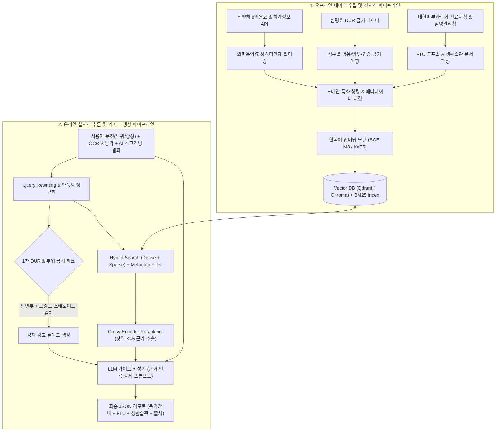

# [프로젝트] AI 기반 피부 병변 스크리닝 및 맞춤형 복약·생활 가이드 웹서비스

## RAG 파이프라인 및 의약품 데이터 전처리 설계서 (v1.0)

### 1. 아키텍처 개요 및 설계 목표
* **설계 목표:** 의료 및 복약 안내에서 치명적인 LLM의 **환각(Hallucination)을 원천 차단**하고, 환자의 **병변 부위·기저질환·복용 약물**에 따라의학적으로 검증된 맞춤형 가이드를 생성한다.
* **핵심 전략:**
  1. **도메인 특화 데이터 필터링:** 방대한 전체 의약품 DB 중 피부과 처방에 집중되는 **외피용약(분류번호 260번대)**과 **항히스타민제(141번)·부신피질호르몬제(245번)**를 우선 구축한다.
  2. **하이브리드 검색(Hybrid Search) + 메타데이터 필터링:** 약품명/성분명의 정확한 매칭을 위한 **BM25(키워드 검색)**와 증상/생활 습관 의미 검색을 위한 **Dense Vector Search**를 결합한다.
  3. **2중 안전장치(DUR Rule-Base + RAG):** 스테로이드 강도 등급 및 임부·병용 금기는 1차적으로 정형 룰베이스(DUR)로 필터링한 뒤, LLM 프롬프트에 강제 주입한다.

---

### 2. 전체 파이프라인 흐름도 (End-to-End Architecture)



---

### 3. 원천 데이터 수집 및 전처리 명세

#### 3.1 원천 데이터셋 구성
| 데이터 구분 | 출처 | 수집 방식 | 주요 추출 항목 |
| :--- | :--- | :--- | :--- |
| **의약품 개요 정보** | 식약처 `e약은요` (공공데이터포털) | REST API / CSV | 품목기준코드, 제품명, 주성분, 효능효과, 용법용량, 사용상 주의사항, 상호작용, 부작용 |
| **외용제 전문 허가정보** | 식약처 `의약품 제품 허가정보` | REST API | 약효분류번호(`261~269` 외피용약), 스테로이드 강도 등급(1~7등급), 제형(연고/크림/로션/겔) |
| **의약품 안전사용(DUR)** | 건강보험심사평가원(HIRA) | 공공데이터 CSV | 병용금기 성분쌍, 임부금기 등급(1·2등급), 특정연령대 금기, 동일효능군 중복주의 |
| **임상·생활 습관 지침** | 대한피부과학회 / 질병관리청 국가건강정보포털 | PDF / 웹 크롤링 | 질환별(아토피, 건선, 접촉피부염 등) 생활 관리, FTU(Finger-Tip Unit) 정량 도포 가이드 |

#### 3.2 데이터 정제 및 전처리 규칙
1. **HTML/특수문자 클렌징 및 표 구조 마크다운 변환:**
   * 식약처 API 응답 내 포함된 HTML 태그(`<p>`, `<table>`, `<tr>`)를 제거하되, **용법·용량 및 금기 표 데이터는 Markdown Table 형태로 보존**하여 LLM이 수치를 오독하지 않도록 처리한다.
2. **약품명 및 성분명 정규화(Normalization):**
   * OCR로 추출된 약봉투 텍스트의 오타나 제형 표기(예: `리도멕스크림0.3%`, `리도멕스 크림`)를 표준 품목기준코드(`ITEM_SEQ`)와 매핑하기 위해 **동의어 사전(Alias Dictionary)**을 구축한다.
3. **피부과 특화 메타데이터 태깅(Metadata Enrichment):**
   * 각 문서 청크(Chunk)를 벡터 DB에 적재할 때 아래의 구조화된 메타데이터를 함께 저장한다.
   ```json
   {
     "doc_id": "MFDS_200401234_02",
     "source_type": "DRUG_INFO",
     "drug_name": "리도멕스크림0.3%",
     "ingredient": "프레드니솔론발레로아세테이트",
     "drug_category": "TOPICAL_STEROID",
     "steroid_potency_class": 5,
     "safe_for_face": true,
     "pregnancy_warning": "GRADE_2",
     "target_diseases": ["아토피피부염", "접촉피부염", "습진"]
   }
   ```

---

### 4. 청킹(Chunking) 및 임베딩 전략

#### 4.1 문서 유형별 맞춤형 청킹 전략
* **의약품 설명서 (구조 기반 분할 - Semantic Section Splitting):**
  * 글자 수로 무작위 분할할 경우 '효능'과 '금기사항'이 섞여 오답을 유발할 수 있으므로, **의약품 항목 단위(`효능효과` / `용법용량` / `사용상 주의사항` / `상호작용`)로 독립 청킹**한다.
  * 모든 하위 청크 상단에는 `[약품명: OO연고 | 성분: XX | 분류: 외용 스테로이드 5등급]` 헤더를 강제 삽입(Contextual Header)하여 검색 정확도를 높인다.
* **의학 가이드라인 및 생활 습관 문서 (Recursive Character + Overlap):**
  * 문단 및 소제목(`##`) 기준으로 분할하되, **Chunk Size: 512 Tokens / Overlap: 64 Tokens**를 적용하여 문맥 단절을 방지한다.

#### 4.2 임베딩 및 벡터 DB 구성
* **임베딩 모델:** `BAAI/bge-m3` 또는 `nlpai-lab/KoE5` (한국어 의학 용어 및 다국어 성분명 혼합 텍스트에서 우수한 검색 성능 제공, Dense + Sparse 동시 지원)
* **벡터 데이터베이스:** **Qdrant** (메타데이터 기반 사전 필터링 `Payload Filtering` 속도가 빠르고, Dense/Sparse 하이브리드 검색을 네이티브로 지원)

---

### 5. 추론 및 환각 방지(Guardrails) 파이프라인

#### 5.1 3단계 검색 파이프라인 (Retrieval Pipeline)
1. **1단계 — 사전 안전 필터링 (Pre-Filtering & DUR Check):**
   * 사용자 프로필(`is_pregnant_or_nursing = True`) 또는 병변 부위(`body_part = 'FACE'`) 정보를 확인한다.
   * 처방약 목록 중 **안면부 사용 부적합 고강도 스테로이드(1~3등급)** 또는 **임부 금기 성분**이 감지되면 즉시 시스템 경고 객체(`dur_warnings`)를 생성한다.
2. **2단계 — 하이브리드 검색 (Hybrid Retrieval):**
   * **약물 검색 쿼리:** `drug_name` 및 `ingredient` 메타데이터 필터 + BM25 키워드 매칭으로 해당 약품의 정확한 용법과 주의사항 청크를 추출한다.
   * **질환/생활 가이드 쿼리:** `target_diseases` 필터 + Dense Vector 유사도 검색으로 스크리닝된 질환(예: 아토피 피부염)의 보습, 목욕, 식단, FTU 도포 가이드를 추출한다.
3. **3단계 — 재순위화 (Reranking):**
   * `BAAI/bge-reranker-v2-m3` 모델을 통해 검색된 상위 15개 청크와 사용자 문진 쿼리 간의 관련도를 재계산하여 **최종 상위 5개(Top-5) 핵심 근거 문서**만 LLM 컨텍스트에 전달한다.

#### 5.2 프롬프트 엔지니어링 및 출력 제어 (Output Guardrails)
* **근거 기반 응답 강제 (Grounded Generation):**
  * 시스템 프롬프트에 *"제공된 `[참고 근거 문서]`에 명시되지 않은 의학적 효능이나 복용법은 절대 추측하여 작성하지 마시오. 근거가 부족할 경우 '전문의 또는 약사와 상담이 필요합니다'라고 명시하시오."* 지침을 고정한다.
* **인용 출처 매핑 (Citation Tracking):**
  * LLM이 응답을 생성할 때 각 문단 끝에 참조한 문서의 `[doc_id]`를 태깅하도록 강제하고, 백엔드 후처리에서 이를 실제 문서 제목 및 기관명(예: `식약처 의약품안전나라 - 리도멕스크림0.3%`)으로 치환하여 사용자 화면에 투명하게 노출한다.
* **Structured Outputs (JSON Schema 강제):**
  * 프론트엔드 렌더링 및 `HEALTH_GUIDES` 테이블 적재를 위해 OpenAI/vLLM의 Structured Outputs 기능을 사용하여 정해진 JSON 스키마로만 응답을 반환받는다.