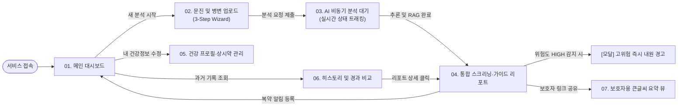

# [프로젝트] AI 기반 피부 병변 스크리닝 및 맞춤형 복약·생활 가이드 웹서비스

## 화면 와이어프레임 및 UI/UX 설계서 (v1.0)

### 1. UI/UX 설계 개요 및 핵심 원칙
* **타겟 디바이스:** 반응형 웹 (Desktop Web 1440px 및 Mobile Web 390px 기준)
* **핵심 UX 설계 원칙:**
  1. **단계별 입력(Progressive Disclosure):** 의료 문진과 이미지 업로드의 심리적 부담을 줄이기 위해 3단계 스텝퍼(Stepper) UI를 채택한다.
  2. **설명 가능한 신뢰성(Explainable UI):** AI 스크리닝 결과와 함께 Grad-CAM 히트맵 오버레이 슬라이더와 RAG 근거 출처 배지를 배치하여 정보의 신뢰도를 높인다.
  3. **안전 최우선 시각 계층(Safety-First Hierarchy):** 고위험 병변(Red Flag) 경고, DUR 병용금기, 안면부 고강도 스테로이드 경고는 최상단 고대비 알림 배너로 우선 노출한다.

---

### 2. 전체 사용자 흐름도 (User Flow)



---

### 3. 화면 목록표 (Information Architecture)

| 화면 ID | 화면명 | 주요 기능 및 관련 요구사항 | 접근 권한 |
| :--- | :--- | :--- | :---: |
| **SCR-01** | 메인 대시보드 | 새 분석 CTA, 오늘의 복약/연고 체크리스트, **스테로이드 연속 사용 트래커**, 최근 리포트 요약 (`REQ-06, 11`) | 회원 |
| **SCR-02** | 문진 및 병변 업로드 | 인체 일러스트 부위 선택, 병변 사진 촬영/업로드, 증상 슬라이더, **처방전/약봉투 OCR 스캔** (`REQ-02, 07`) | 회원 |
| **SCR-03** | AI 비동기 분석 대기 | Redis/Celery 작업 진행률 실시간 표시(4단계), 대기 중 피부 상식 카드 (`REQ-05`) | 회원 |
| **SCR-04** | 통합 스크리닝·가이드 리포트 | **Grad-CAM 투명도 비교**, Top-3 질환 확률, **DUR/부위 경고 배너**, **FTU 도포 가이드**, 생활습관, 의사 질문 3선 (`REQ-03, 04, 08, 09, 10`) | 회원 |
| **SCR-05** | 내 건강 프로필·복용약 관리 | 기저질환, 약물 알레르기, 임신/수유 여부 설정, 상시 복용약/영양제 등록 (`REQ-01, 08`) | 회원 |
| **SCR-06** | 히스토리 및 경과 비교 | 날짜별 진료/분석 타임라인, **Before & After 병변 사진 나란히 비교 뷰** (`REQ-06`) | 회원 |
| **SCR-07** | 보호자·가족 공유 요약 뷰 | 비로그인 공유 링크 전용 큰 글씨 모바일 뷰(약 바르는 법, 주의사항, 의사 질문 요약) (`REQ-10`) | 비회원(링크) |

---

### 4. 화면별 상세 와이어프레임 및 컴포넌트 명세

#### 4.1 [SCR-01] 메인 대시보드 (Home Dashboard)

```text
+-----------------------------------------------------------------------------------+
| [LOGO] SkinCare AI              [대시보드]  [분석 히스토리]  [내 건강프로필]  [김OO님] |
+-----------------------------------------------------------------------------------+
|                                                                                   |
|  +-----------------------------------------------------------------------------+  |
|  |  피부 고민이 있으신가요? 사진과 증상으로 맞춤형 복약·생활 가이드를 받아보세요.       |  |
|  |                                              [ + 새 피부 병변 분석 시작하기 ]  |  |
|  +-----------------------------------------------------------------------------+  |
|                                                                                   |
|  +-------------------------------------+  +-------------------------------------+  |
|  | 📅 오늘의 복약 및 연고 도포 스케줄     |  | ⚠️ 외용 스테로이드 사용 트래커         |  |
|  |                                     |  |                                     |  |
|  | [v] 아침 | 세티리진정 1정 (식후 30분)  |  | 현재 사용약: 리도멕스크림 0.3% (5등급) |  |
|  | [ ] 저녁 | 리도멕스크림 얇게 도포     |  | 연속 사용일: [■■■■■□□] 5일 / 권장 7일 |  |
|  | [ ] 취침전 | 세라마이드 보습제 도포    |  | 안내: 2일 후 휴약기 권장 (피부 위축 예방) |  |
|  +-------------------------------------+  +-------------------------------------+  |
|                                                                                   |
|  [최근 분석 리포트 요약]                                                            |
|  +-----------------------------------------------------------------------------+  |
|  | 2026.11.15 | 부위: 팔 접히는 부위 | 1순위 의심: 아토피 피부염 (84%)  [리포트 보기 >] |  |
|  +-----------------------------------------------------------------------------+  |
|                                                                                   |
+-----------------------------------------------------------------------------------+
| ※ 본 서비스는 AI 기반 참고용 정보를 제공하며, 의사의 전문적인 의학적 진단을 대체할 수 없습니다.  |
+-----------------------------------------------------------------------------------+
```

* **주요 UI 컴포넌트 명세:**
  * **복약 체크리스트 위젯 (`MEDICATION_SCHEDULES` 연동):** 체크박스 클릭 시 `PATCH /api/v1/schedules/{id}/check` 호출로 복약 순응도 기록.
  * **스테로이드 사용 트래커:** 동일 부위 연속 도포 일수를 시각화하여 장기 연용 부작용을 사전에 예방.

---

#### 4.2 [SCR-02] 문진 및 병변 업로드 (3-Step Wizard)

```text
+-----------------------------------------------------------------------------------+
| < 뒤로가기                     새 피부 병변 및 진료 기록 분석                        |
+-----------------------------------------------------------------------------------+
|        ( 1. 병변 부위 선택 ) ─────── ( 2. 병변 사진 업로드 ) ─────── ( 3. 증상 및 처방전 ) |
+-----------------------------------------------------------------------------------+
|                                                                                   |
|  [Step 1: 인체 부위 선택]                 |  [Step 3: 증상 및 처방전 OCR (최종 단계)]   |
|                                         |                                         |
|        (앞면)   (뒷면)                   |  * 주요 증상 양상 (다중 선택)             |
|          [머리/얼굴]                     |    [v] 붉어짐(홍반)  [v] 각질(인설)       |
|         /    |    \                     |    [ ] 물집(수포)    [ ] 진물/딱지        |
|      [팔]  [몸통]  [팔]                  |                                         |
|         \    |    /                     |  * 가려움증 강도:  0 ───●─────── 10 (6점) |
|         [다리] [다리]                    |                                         |
|                                         |  * 처방전 / 약봉투 자동 입력 (선택)       |
|  선택된 부위: [ 얼굴 (FACE) ]             |    +-------------------------------+    |
|  ※ 얼굴·목 부위는 약물 흡수율이 높아       |    | [📷 처방전/약봉투 사진 업로드]  |    |
|    연고 강도 안전 검증이 강화됩니다.       |    | 추출된 약물: 에바스텔정, 더모베이트연고 |    |
|                                         |    +-------------------------------+    |
|                                         |               [ AI 분석 및 가이드 생성 ]  |
+-----------------------------------------------------------------------------------+
```

* **주요 UI 컴포넌트 명세:**
  * **인체 인터랙티브 SVG 맵:** 클릭된 부위 코드(`FACE`, `NECK`, `TRUNK` 등)를 `SKIN_RECORDS.body_part`에 매핑.
  * **촬영 가이드 & 비식별화 토글:** 사진 업로드 시 *"초점을 맞추고 플래시를 꺼주세요"* 가이드 표시 및 안면부 눈/입 자동 모자이크 옵션 제공(`REQ-N02`).
  * **처방전 OCR 추출 박스:** 업로드 즉시 OCR API를 호출해 인식된 약품명을 태그(Tag) 형태로 표시하며, 사용자가 직접 오타를 수정/삭제 가능.

---

#### 4.3 [SCR-03] AI 비동기 분석 대기 화면 (Async Progress View)

```text
+-----------------------------------------------------------------------------------+
|                                                                                   |
|                        🔬 AI가 병변과 의약품 데이터를 분석하고 있습니다                  |
|                        예상 소요 시간: 약 8~12초 (창을 닫아도 분석은 유지됩니다)         |
|                                                                                   |
|  [■■■■■■■■■■■■■■□□□□□□] 70% 진행 중                                                |
|                                                                                   |
|  +-----------------------------------------------------------------------------+  |
|  |  ✔ [완료] 병변 이미지 전처리 및 개인정보 비식별화 완료                            |  |
|  |  ✔ [완료] 피부 질환 AI 스크리닝 및 Grad-CAM 병변 영역 추출 완료                 |  |
|  |  🔄 [진행중] 식약처 e약은요 및 심평원 DUR 금기사항 대조 중...                    |  |
|  |  ⏳ [대기] 부위별 FTU 정량 도포법 및 맞춤형 생활 습관 가이드 생성                  |  |
|  +-----------------------------------------------------------------------------+  |
|                                                                                   |
|  💡 기다리는 동안 알아두는 피부 상식                                                  |
|  "연고는 많이 바른다고 빨리 낫지 않아요! 검지 손가락 끝마디 한 줄(1 FTU)이면           |
|   성인 손바닥 두 개 넓이를 충분히 바를 수 있습니다."                                  |
|                                                                                   |
+-----------------------------------------------------------------------------------+
```

* **주요 UI 컴포넌트 명세:**
  * **실시간 상태 폴링/SSE 바 (`ANALYSIS_TASKS` 연동):** `GET /api/v1/tasks/{task_id}`를 1.5초 주기로 조회(또는 SSE 구독)하여 `progress_percent`에 따라 체크 아이콘을 동적으로 업데이트.

---

#### 4.4 [SCR-04] 통합 스크리닝 및 맞춤형 가이드 리포트 (Core Result)

```text
+-----------------------------------------------------------------------------------+
| [리포트 #20261116-01] 분석일시: 2026.11.16 14:30    [📄 PDF 저장] [🔗 보호자 공유]  |
+-----------------------------------------------------------------------------------+
| 🚨 [중요 안전 경고 - DUR 및 부위 금기 감지]                                          |
| 입력하신 '더모베이트연고(1등급 초강력 스테로이드)'는 선택하신 [얼굴] 부위에 사용 시     |
| 모세혈관 확장 및 피부 위축 위험이 매우 높습니다. 반드시 의사·약사 확인 후 사용하세요!    |
+-----------------------------------------------------------------------------------+
|                                                                                   |
| [1. AI 질환 스크리닝 및 XAI 분석]          | [2. RAG 기반 맞춤형 복약 & FTU 도포 가이드] |
|                                         |                                         |
|  +----------------+  +---------------+  |  ■ 처방약 복약 및 도포 안내                |
|  |   원본 이미지   |  | Grad-CAM 히트맵|  |  1) 에바스텔정 (항히스타민제)             |
|  |                |  |  (붉은 영역:  |  |     - 용법: 1일 1회 1정 경구 복용          |
|  |                |  |   AI 주목부위) |  |     - 주의: 졸음 유발 가능, 운전 주의     |
|  +----------------+  +---------------+  |     - [근거: 식약처 e약은요 #MFDS-1024]   |
|  히트맵 투명도: [ 0% ────●──── 100% ]     |                                         |
|                                         |  ■ 부위별 정량 도포 가이드 (FTU)           |
|  * 스크리닝 유사도 결과 (참고용)           |  [손가락 1마디 일러스트]                   |
|    1위. 접촉성 피부염 (78.5%) ████████   |  - 얼굴 전체 기준: 약 2.5 FTU (1.25g)      |
|    2위. 아토피 피부염 (15.2%) ██         |  - 보습제를 먼저 바른 뒤 15분 후 도포 권장  |
|    3위. 지루성 피부염 ( 4.1%) █          |                                         |
|                                         |  [ 🔔 이 처방으로 복약 알림 등록하기 ]    |
+-----------------------------------------------------------------------------------+
| [3. 맞춤형 생활 습관 관리 체크리스트]      | [4. 다음 진료 시 의사에게 물어볼 질문 Top 3] |
|  □ 미온수(32~34도)로 10분 이내 가볍게 세안 |  Q1. 얼굴 부위인데 현재 연고 강도를 낮춰야 할까요? |
|  □ 세안 직후 3분 이내 무향료 보습제 도포   |  Q2. 진물이 멈춘 뒤 보습제만 유지해도 될까요?   |
|  □ 실내 습도 45~55% 유지 및 면 소재 착용  |  Q3. 항히스타민제 복용 후 졸음이 심하면 변경 가능할까요?|
|  [근거: 대한피부과학회 진료지침 #KDA-08]   |                          [ 📋 질문 복사 ] |
+-----------------------------------------------------------------------------------+
| ※ 본 결과는 AI 분석에 기반한 참고용 정보이며, 의사의 전문적인 진단을 대체할 수 없습니다.   |
+-----------------------------------------------------------------------------------+
```

* **고위험 병변(Red Flag) 모달 분기 (`risk_level == 'HIGH_URGENT'`):**
  * 악성 흑색종 등 즉각적인 조직검사가 필요한 패턴이 탐지되면 화면 진입 즉시 **[전문의 즉시 내원 권고 모달]**을 띄우고 `[📍 내 주변 피부과 전문의 병원 찾기]` 버튼을 최우선 제공.

---

#### 4.5 [SCR-05] 내 건강 프로필 / [SCR-06] 경과 비교 / [SCR-07] 보호자 공유 뷰

* **[SCR-05] 내 건강 프로필 및 상시 복용약 관리:**
  * **기저질환 태그 선택:** `#아토피`, `#당뇨`, `#고혈압`, `#간/신장질환`
  * **약물 알레르기 입력:** 성분명 자동완성 검색 및 등록.
  * **안전 필터 토글:** `[임신 중 또는 수유 중입니다]` 스위치 (ON 설정 시 레티노이드·임부금기 약물 자동 경고).
  * **상시 복용약/영양제 등록:** 기존 복용약과 신규 피부과 처방약 간 DUR 병용금기 대조에 활용.

* **[SCR-06] 히스토리 및 경과 비교 (Before & After):**
  ```text
  +-----------------------------------------------------------------------------------+
  | [경과 비교 모드] 동일 부위(팔 접히는 부위) 호전도 비교                                 |
  +-----------------------------------------------------------------------------------+
  |  [과거 기록: 2026.11.01]                 |  [최근 기록: 2026.11.16]                 |
  |  +-----------------------------------+  |  +-----------------------------------+  |
  |  |        (병변 사진 - 초기)          |  |  |        (병변 사진 - 2주 후)        |  |
  |  +-----------------------------------+  |  +-----------------------------------+  |
  |  가려움 지수: 8점 / 홍반·진물 동반        |  가려움 지수: 3점 (▼5점 감소) / 각질 완화   |
  +-----------------------------------------------------------------------------------+
  ```

* **[SCR-07] 보호자·부모님 전용 공유 요약 뷰 (Mobile Read-Only):**
  * 카카오톡/문자 공유 URL(`https://service.com/share/{share_token}`) 접속 시 로그인 없이 열리는 **큰 글씨(18pt 이상) 모바일 카드 UI**.
  * 복잡한 의학 확률 수치는 숨기고 **"1. 어떤 약을 언제 바르나요?", "2. 절대 주의할 점(얼굴 도포 금지 등)", "3. 병원 갈 때 의사에게 보여줄 요약"** 3가지만 직관적으로 표시.