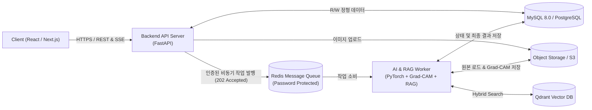
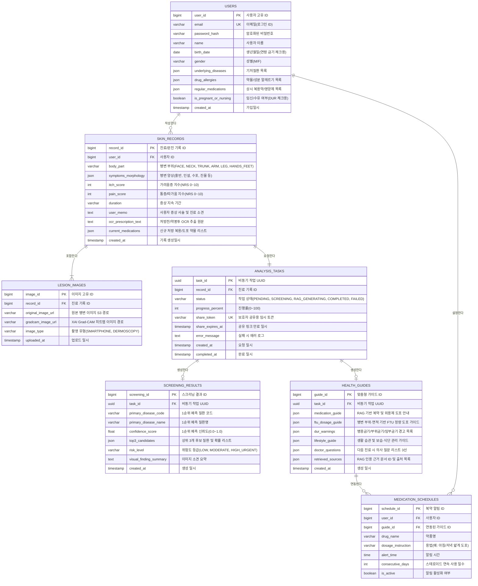
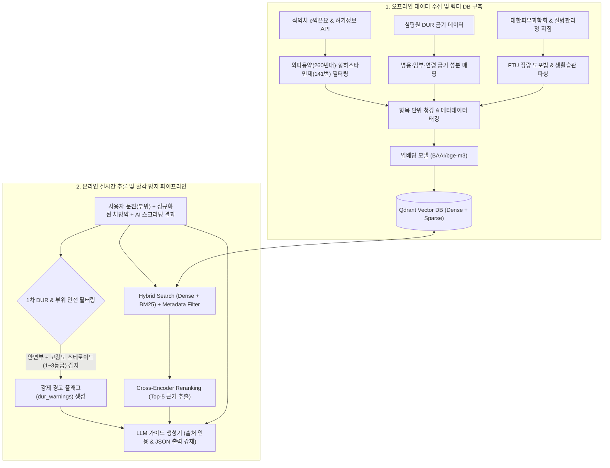

[code_artifact.md](https://github.com/user-attachments/files/34904218/code_artifact.md)
# [프로젝트 통합 기획 및 설계서] 

# AI 기반 피부 병변 스크리닝 및 맞춤형 복약·생활 가이드 웹서비스

* **문서 버전:** v1.1 (Security Architecture Integrated)
* **작성일:** 2026-11-16
* **포함 내역:** 1. 프로젝트 개요 및 시스템 아키텍처 / 2. 요구사항 정의서 / 3. 데이터베이스 ERD 및 테이블 명세서 / 4. RAG 파이프라인 및 의약품 전처리 설계서 / 5. 화면 와이어프레임 설계서 / 6. REST API 정의서 / 7. 보안 및 의료 데이터 보호 설계서

---

## 목차 (Table of Contents)
1. [프로젝트 개요 및 시스템 아키텍처](#1-프로젝트-개요-및-시스템-아키텍처)
2. [요구사항 정의서 (SRS)](#2-요구사항-정의서-srs)
3. [데이터베이스 ERD 및 테이블 명세서](#3-데이터베이스-erd-및-테이블-명세서)
4. [RAG 파이프라인 및 의약품 데이터 전처리 설계서](#4-rag-파이프라인-및-의약품-데이터-전처리-설계서)
5. [화면 와이어프레임 및 UI/UX 설계서](#5-화면-와이어프레임-및-uiux-설계서)
6. [REST API 정의서](#6-rest-api-정의서)
7. [보안 및 의료 데이터 보호 설계서 (Security & Compliance)](#7-보안-및-의료-데이터-보호-설계서-security--compliance)

---

## 1. 프로젝트 개요 및 시스템 아키텍처

### 1.1 추진 배경 및 서비스 목표
* **도메인 특화 전략 (피부 병변 타겟):** 스마트폰 촬영으로 일상적인 접근이 가능하고, 처방 후 **외용제(연고)의 올바른 도포법(FTU) 및 보습·환경 관리** 연계 효과가 가장 뛰어난 **피부 질환 스크리닝 및 복약·생활 가이드**를 핵심 도메인으로 설정한다.
* **핵심 가치:**
  1. **설명 가능한 AI 스크리닝 (XAI):** 피부 병변 이미지 분석 결과와 함께 **Grad-CAM 히트맵**을 제공하여 AI의 판단 근거를 시각화한다.
  2. **환각(Hallucination) 없는 복약 가이드:** 식약처 `e약은요`, 심평원 `DUR` 금기 데이터, 대한피부과학회 진료지침 기반 **RAG 파이프라인**을 통해 근거 중심의 안전한 복약·생활 안내를 제공한다.
  3. **고동시성 비동기 아키텍처:** 딥러닝 추론과 LLM 생성에 소요되는 시간을 **FastAPI + Redis + AI Worker** 기반 비동기 큐로 분리하여 안정적인 응답성과 실시간 진행률 트래킹을 보장한다.

### 1.2 전체 시스템 아키텍처 (System Architecture)



---

## 2. 요구사항 정의서 (SRS)

### 2.1 핵심 기능 요구사항 (MVP)

| ID | 구분 | 기능명 | 상세 설명 | 우선순위 |
| :--- | :--- | :--- | :--- | :---: |
| **REQ-01** | 회원/프로필 | 기저질환 및 알레르기 관리 | 사용자 가입 및 건강 프로필(기저질환, 약물 알레르기, 임신/수유 여부, 상시 복용약) 등록·수정 | 상 |
| **REQ-02** | 데이터 입력 | 문진 및 피부 병변 업로드 | 인체 부위 선택, 자각 증상(가려움/통증) 입력 및 병변 이미지(JPG/PNG) 업로드 | 상 |
| **REQ-03** | AI 스크리닝 | 피부 병변 스크리닝 및 XAI | 딥러닝 기반 Top-3 유사 질환 확률 산출, 위험도 등급 판별 및 **Grad-CAM 히트맵** 제공 | 상 |
| **REQ-04** | AI 가이드 | RAG 기반 맞춤형 복약·생활 가이드 | 식약처·학회 지식 베이스 검색을 통한 복용법, **FTU 정량 도포법**, 식단·보습 생활 가이드 생성 | 상 |
| **REQ-05** | 비동기/시스템 | 비동기 작업 상태 실시간 트래킹 | Redis 큐 기반 비동기 처리 및 진행 단계(`PENDING` → `SCREENING` → `RAG_GENERATING` → `COMPLETED`) 표시 | 상 |
| **REQ-06** | 이력 관리 | 분석 히스토리 및 경과 비교 | 날짜별 과거 기록 조회 및 동일 부위 **Before & After 사진 나란히 비교** 기능 | 중 |

### 2.2 실생활 활용도 강화 기능 (Value-Add)

| ID | 기능명 | 실생활 시나리오 및 상세 설명 | 구현 난이도 |
| :--- | :--- | :--- | :---: |
| **REQ-07** | **처방전 / 약봉투 OCR 스캔** | 스마트폰으로 약봉투나 처방전을 촬영해 올리면 OCR 및 의약품 동의어 매핑으로 약품명 자동 입력 | 중 |
| **REQ-08** | **DUR 병용금기 및 부위 금기 경고** | 기존 복용약과의 상호작용, 임부 금기 및 **안면부 고강도 스테로이드 도포 주의** 자동 경고 | 중 |
| **REQ-09** | **다음 진료 시 의사 질문 리스트 3선** | 스크리닝 결과와 복약 주의사항을 바탕으로 다음 내원 시 의사에게 물어볼 핵심 질문 3가지 요약 | 하 |
| **REQ-10** | **보호자 공유 뷰 및 PDF 출력** | 부모님·가족용 **비로그인 큰 글씨 요약 링크** 공유 및 병원 제출용 PDF 리포트 저장 | 하 |
| **REQ-11** | **복약 스케줄 및 스테로이드 트래커** | 일일 복약·연고 도포 알림 등록 및 동일 부위 스테로이드 연속 사용 일수(휴약기) 트래킹 | 중 |

### 2.3 비기능 및 법적 필수 요구사항
* **REQ-N01 (의료법 면책 고지):** 모든 스크리닝 및 가이드 화면 하단에 *"본 결과는 AI 분석에 기반한 참고용 정보이며, 의사의 전문적인 의학적 진단을 대체할 수 없습니다"* 문구를 상시 노출한다.
* **REQ-N02 (민감정보 보안 및 비식별화):** 비밀번호 단방향 암호화(Bcrypt) 및 업로드 이미지 내 안면부/개인 식별 영역 마스킹 비식별화 옵션을 제공한다.
* **REQ-N03 (동시성 및 응답 성능):** 동시 요청 환경에서도 API 서버는 1초 이내에 `202 Accepted`를 반환하며, 전체 AI 파이프라인 추론은 15초 이내 완료를 목표로 한다.

---

## 3. 데이터베이스 ERD 및 테이블 명세서

### 3.1 ERD (Entity-Relationship Diagram)



### 3.2 핵심 테이블 상세 명세 요약
* **`USERS`:** `user_id(PK)`, `email(UK)`, `password_hash`, `birth_date`, `gender`, `underlying_diseases(JSON)`, `drug_allergies(JSON)`, `regular_medications(JSON)`, `is_pregnant_or_nursing(BOOLEAN)`
* **`SKIN_RECORDS`:** `record_id(PK)`, `user_id(FK)`, `body_part(FACE/NECK/TRUNK/ARM/LEG/HANDS_FEET/GROIN)`, `symptoms_morphology(JSON)`, `itch_score(0~10)`, `pain_score(0~10)`, `ocr_prescription_text`, `current_medications(JSON)`
* **`LESION_IMAGES`:** `image_id(PK)`, `record_id(FK)`, `original_image_url`, `gradcam_image_url`, `image_type`
* **`ANALYSIS_TASKS`:** `task_id(UUID, PK)`, `record_id(FK)`, `status(PENDING | SCREENING | RAG_GENERATING | COMPLETED | FAILED)`, `progress_percent(0~100)`, `share_token`, `share_expires_at`
* **`SCREENING_RESULTS`:** `screening_id(PK)`, `task_id(FK)`, `primary_disease_code`, `primary_disease_name`, `confidence_score`, `top3_candidates(JSON)`, `risk_level(LOW | MODERATE | HIGH_URGENT)`, `visual_finding_summary`
* **`HEALTH_GUIDES`:** `guide_id(PK)`, `task_id(FK)`, `medication_guide(JSON)`, `ftu_dosage_guide(JSON)`, `dur_warnings(JSON)`, `lifestyle_guide(JSON)`, `doctor_questions(JSON)`, `retrieved_sources(JSON)`
* **`MEDICATION_SCHEDULES`:** `schedule_id(PK)`, `user_id(FK)`, `guide_id(FK)`, `drug_name`, `dosage_instruction`, `alert_time`, `consecutive_days`, `is_active`

---

## 4. RAG 파이프라인 및 의약품 데이터 전처리 설계서

### 4.1 RAG 파이프라인 흐름도



### 4.2 데이터 전처리 및 안전 가드레일 규칙
1. **원천 데이터 정제 및 정규화:**
   * 식약처 API 응답의 HTML 태그를 제거하되 **용법·용량 표는 Markdown Table로 보존**한다.
   * OCR 추출 약품명은 식약처 표준 품목기준코드(`ITEM_SEQ`) 기반 **동의어 사전(Alias Dictionary) 및 유사도 매칭(Fuzzy Matching)**을 거쳐 정규화한다.
2. **도메인 특화 청킹 및 메타데이터 태깅:**
   * 의약품 설명서는 `효능효과`, `용법용량`, `사용상 주의사항`, `상호작용` 섹션 단위로 분할하고 상단에 `[약품명 | 주성분 | 스테로이드 등급]` 헤더를 삽입한다.
   * Qdrant Payload에 `steroid_potency_class(1~7)`, `safe_for_face(bool)`, `pregnancy_warning`, `target_diseases` 메타데이터를 태깅한다.
3. **2중 환각 방지(Guardrails) 메커니즘:**
   * **Rule-Based 사전 검증:** `body_part == 'FACE'`이면서 처방 연고가 1~3등급 고강도 스테로이드인 경우, LLM 생성 이전 단계에서 시스템 경고 객체를 확정 생성한다.
   * **Grounded Generation & Citation:** 제공된 Top-5 근거 문서 외 추측성 의학 조언 생성을 금지하고, 모든 가이드 항목에 `doc_id` 출처 매핑을 강제한다.

---

## 5. 화면 와이어프레임 및 UI/UX 설계서

### 5.1 화면 목록표 (Information Architecture)

| 화면 ID | 화면명 | 주요 기능 및 연동 데이터 | 접근 권한 |
| :--- | :--- | :--- | :---: |
| **SCR-01** | 메인 대시보드 | 새 분석 CTA, 오늘의 복약/연고 체크리스트, **스테로이드 연속 사용 트래커**, 최근 리포트 요약 | 회원 |
| **SCR-02** | 문진 및 병변 업로드 | 인체 SVG 부위 선택, 병변 사진 업로드(비식별화 토글), 증상 슬라이더, **처방전/약봉투 OCR 스캔** | 회원 |
| **SCR-03** | AI 비동기 분석 대기 | 4단계 실시간 진행률 바(`PENDING` → `SCREENING` → `RAG_GENERATING` → `COMPLETED`), 피부 상식 카드 | 회원 |
| **SCR-04** | 통합 스크리닝·가이드 리포트 | **Grad-CAM 투명도 비교 슬라이더**, Top-3 확률, **DUR/부위 경고 배너**, **FTU 도포 일러스트**, 생활습관, 의사 질문 3선 | 회원 |
| **SCR-05** | 내 건강 프로필·복용약 관리 | 기저질환, 알레르기, 임신/수유 여부 토글, 상시 복용약/영양제 등록 | 회원 |
| **SCR-06** | 히스토리 및 경과 비교 | 날짜별 기록 타임라인, 동일 부위 **Before & After 병변 사진 비교 뷰** | 회원 |
| **SCR-07** | 보호자·가족 공유 요약 뷰 | 비로그인 공유 링크 전용 큰 글씨(18pt+) 모바일 카드 뷰(도포법, 주의사항, 의사 질문 요약) | 비회원(링크) |

### 5.2 핵심 화면 와이어프레임 레이아웃

#### ① `[SCR-01]` 메인 대시보드 & `[SCR-02]` 3-Step 문진·업로드
```text
[SCR-01 메인 대시보드]                                [SCR-02 문진 및 병변 업로드 (3-Step)]
+---------------------------------------------+      +---------------------------------------------+
| [LOGO] SkinCare AI   [대시보드] [기록] [프로필]|      | (1. 부위 선택) ── (2. 사진) ── (3. 증상/OCR) |
+---------------------------------------------+      +---------------------------------------------+
| [ + 새 피부 병변 분석 시작하기 ]              |      |  [인체 SVG 맵]       | * 주요 증상 선택      |
+---------------------------------------------+      |   [머리/얼굴]        |  [v] 홍반  [v] 각질   |
| 📅 오늘의 복약 스케줄 | ⚠️ 스테로이드 트래커 |      |   [팔][몸통][팔]     | * 가려움: 0──●──10(6) |
| [v] 아침 세티리진정   | 리도멕스크림 (5등급) |      |   [다리]  [다리]     | [📷 처방전 OCR 스캔]  |
| [ ] 저녁 연고 도포    | [■■■■■□□] 5일/7일   |      | 선택: 얼굴(FACE)     | 추출: 에바스텔,더모베이트|
+---------------------------------------------+      | [v] 안면부 자동마스킹 | [ AI 분석 요청하기 ]  |
| ※ AI 참고용 정보이며 의사 진단을 대체할 수 없음|      +---------------------------------------------+
+---------------------------------------------+
```

#### ② `[SCR-03]` 비동기 대기 화면 & `[SCR-04]` 통합 스크리닝·가이드 리포트
```text
[SCR-03 AI 비동기 분석 대기]                         [SCR-04 통합 스크리닝 및 가이드 리포트]
+---------------------------------------------+      +---------------------------------------------+
| 🔬 AI가 병변과 의약품 데이터를 분석 중입니다   |      | [리포트 #20261116-01]  [📄 PDF] [🔗 보호자공유]|
| [■■■■■■■■■■■■■■□□□□□□] 70% (RAG_GENERATING) |      +---------------------------------------------+
+---------------------------------------------+      | 🚨 [DUR 경고] '더모베이트연고(1등급)'는 [얼굴] |
| ✔ [완료] 이미지 전처리 및 비식별화 완료      |      |    부위 사용 시 피부 위축 위험이 높습니다!     |
| ✔ [완료] 피부 질환 스크리닝 및 Grad-CAM 추출 |      +---------------------------------------------+
| 🔄 [진행] 식약처 e약은요 및 DUR 금기 대조 중  |      | [원본] <-> [Grad-CAM] | ■ 복약 & FTU 가이드   |
| ⏳ [대기] FTU 정량 도포법 및 생활 가이드 생성 |      | 투명도: [0% ──●── 100%]| - 에바스텔정 (졸음주의)|
+---------------------------------------------+      | 1위. 접촉성피부염(78.5%)| - 얼굴 권장: 2.5 FTU   |
| 💡 팁: 검지 끝마디 1줄(1 FTU) = 손바닥 2개 넓이|      | 2위. 아토피피부염(15.2%)| [🔔 복약 알림 등록]    |
+---------------------------------------------+      +---------------------------------------------+
                                                     | ■ 생활 습관 체크리스트 | ■ 의사 질문 Top 3     |
                                                     | □ 미온수 세안/3분 보습 | Q1. 연고 강도 조절 문의|
                                                     +---------------------------------------------+
```

---

## 6. REST API 정의서

### 6.1 공통 규약 및 상태 코드
* **Base URL:** `https://api.skincare-ai.example.com/api/v1`
* **인증:** `Authorization: Bearer <access_token>`
* **비동기 처리:** `POST /records` 요청 시 `202 Accepted`와 `task_id`를 즉시 반환하며, `GET /tasks/{task_id}`(Polling) 또는 `GET /tasks/{task_id}/stream`(SSE)으로 상태를 추적한다.

### 6.2 전체 API 엔드포인트 일람

| 도메인 | Method | URI | 설명 | 상태 코드 | 인증 |
| :--- | :--- | :--- | :--- | :---: | :---: |
| **회원/프로필** | `POST` | `/auth/signup` | 회원가입 | `201` | X |
| **회원/프로필** | `POST` | `/auth/login` | 로그인 및 JWT 발급 | `200` | X |
| **회원/프로필** | `GET` / `PUT` | `/users/me/profile` | 건강 프로필(기저질환, 알레르기, 임부 여부, 상시약) 조회·수정 | `200` | O |
| **문진/업로드** | `POST` | `/ocr/prescription` | 처방전/약봉투 이미지 OCR 스캔 및 표준 약품명 정규화 | `200` | O |
| **문진/업로드** | `POST` | `/records` | 병변 이미지·문진 저장 및 **비동기 AI 분석 작업 큐 등록** | `202` | O |
| **문진/업로드** | `GET` | `/records` | 과거 진료/분석 히스토리 목록 조회 (부위별 경과 비교 필터) | `200` | O |
| **비동기 상태** | `GET` | `/tasks/{task_id}` | AI 분석 작업 진행률(`0~100%`) 및 단계별 상태 조회 | `200` | O |
| **비동기 상태** | `GET` | `/tasks/{task_id}/stream` | AI 분석 작업 진행률 실시간 스트리밍 (SSE) | `200` | O |
| **리포트/공유** | `GET` | `/reports/{task_id}` | 통합 리포트(스크리닝, Grad-CAM, RAG 가이드, DUR 경고) 조회 | `200` | O |
| **리포트/공유** | `POST` | `/reports/{task_id}/share` | 보호자 공유용 비로그인 임시 링크 토큰 발급 | `201` | O |
| **리포트/공유** | `GET` | `/shared/{share_token}` | 보호자용 큰 글씨 요약 리포트 조회 | `200` | X |
| **복약 스케줄** | `POST` | `/schedules` | 리포트 처방 기반 복약·연고 도포 알림 등록 | `201` | O |
| **복약 스케줄** | `GET` | `/schedules/today` | 대시보드 오늘의 복약 스케줄 및 스테로이드 트래커 조회 | `200` | O |
| **복약 스케줄** | `PATCH` | `/schedules/{schedule_id}/check` | 일일 복약/연고 도포 완료 상태 토글 | `200` | O |

### 6.3 핵심 API 입출력 명세 예시

#### ① 피부 병변 분석 및 가이드 생성 요청 (`POST /api/v1/records`)
* **Request (`multipart/form-data`):**
  * `images`: 병변 이미지 파일 (`JPG`, `PNG`, 최대 3장)
  * `payload`:
    ```json
    {
      "body_part": "FACE",
      "symptoms_morphology": ["홍반", "인설"],
      "itch_score": 6,
      "pain_score": 2,
      "duration": "1주 이내",
      "user_memo": "볼 주변이 붉어지고 각질이 일어나며 가렵습니다.",
      "current_medications": ["에바스텔정(에바스틴)", "더모베이트연고0.05%"],
      "apply_deidentification": true
    }
    ```
* **Response (`202 Accepted`):**
  ```json
  {
    "success": true,
    "code": "TASK_QUEUED",
    "message": "AI 분석 작업이 접수되었습니다.",
    "data": {
      "record_id": 502,
      "task_id": "8f9e4b2c-1a3d-4e5f-9b8c-7d6e5f4a3b2c",
      "status": "PENDING",
      "estimated_seconds": 10
    }
  }
  ```

#### ② 분석 작업 상태 조회 (`GET /api/v1/tasks/{task_id}`)
* **Response (`200 OK`):**
  ```json
  {
    "success": true,
    "code": "SUCCESS",
    "data": {
      "task_id": "8f9e4b2c-1a3d-4e5f-9b8c-7d6e5f4a3b2c",
      "status": "RAG_GENERATING",
      "progress_percent": 70,
      "step_description": "식약처 e약은요 및 심평원 DUR 금기사항 대조 중...",
      "error_message": null
    }
  }
  ```

#### ③ 통합 스크리닝·가이드 리포트 조회 (`GET /api/v1/reports/{task_id}`)
* **Response (`200 OK`):**
  ```json
  {
    "success": true,
    "code": "SUCCESS",
    "data": {
      "report_id": "20261116-502",
      "disclaimer": "본 결과는 AI 분석에 기반한 참고용 정보이며, 의사의 전문적인 의학적 진단을 대체할 수 없습니다.",
      "screening": {
        "original_image_url": "https://cdn.skincare-ai.example.com/lesions/502_orig.jpg",
        "gradcam_image_url": "https://cdn.skincare-ai.example.com/lesions/502_cam.jpg",
        "primary_disease_code": "L23.9",
        "primary_disease_name": "접촉성 피부염",
        "confidence_score": 0.785,
        "risk_level": "MODERATE",
        "top3_candidates": [
          { "disease_name": "접촉성 피부염", "probability": 0.785 },
          { "disease_name": "아토피 피부염", "probability": 0.152 },
          { "disease_name": "지루성 피부염", "probability": 0.041 }
        ]
      },
      "guide": {
        "dur_warnings": [
          {
            "severity": "HIGH",
            "warning_type": "BODY_PART_CONTRAINDICATION",
            "drug_name": "더모베이트연고0.05%",
            "message": "1등급 초강력 스테로이드 외용제는 안면부(얼굴) 사용 시 피부 위축 및 모세혈관 확장 위험이 높으므로 전문의 확인 전 도포를 중단하세요."
          }
        ],
        "medication_guide": [
          {
            "drug_name": "에바스텔정(에바스틴)",
            "dosage": "성인 기준 1일 1회 10mg(1정) 경구 복용",
            "precautions": "졸음을 유발할 수 있으므로 운전이나 위험한 기계 조작 시 주의하십시오.",
            "source_id": "MFDS_199801234_03"
          }
        ],
        "ftu_dosage_guide": {
          "body_part_label": "얼굴 및 목 전체",
          "recommended_ftu": 2.5,
          "recommended_grams": 1.25,
          "instruction": "검지 손가락 끝마디 한 줄(1 FTU = 약 0.5g) 기준으로 얼굴 전체에는 약 2.5마디 분량을 보습제 도포 15분 후 얇게 펴 바릅니다."
        },
        "lifestyle_guide": [
          "미온수(32~34°C)로 자극이 적은 약산성 클렌저를 사용해 짧게 세안하세요.",
          "세안 후 3분 이내에 무향료·저자극 보습제를 충분히 도포하세요."
        ],
        "doctor_questions": [
          "현재 처방받은 연고가 얼굴 부위에 사용하기에 강도가 높지 않은지 확인하고 싶습니다.",
          "가려움증이 가라앉은 후 연고 중단 및 보습제 단독 유지 시점은 언제가 좋을까요?",
          "항히스타민제 복용 후 낮 시간 졸음이 심할 경우 다른 성분으로 변경할 수 있을까요?"
        ],
        "retrieved_sources": [
          {
            "doc_id": "MFDS_199801234_03",
            "organization": "식품의약품안전처 의약품안전나라",
            "title": "에바스텔정(에바스틴) 의약품 개요정보(e약은요)"
          },
          {
            "doc_id": "KDA_GUIDE_2025_08",
            "organization": "대한피부과학회",
            "title": "외용 스테로이드제 안전 사용 및 FTU 정량 도포 가이드라인"
          }
        ]
      }
    }
  }
  ```

---

## 7. 보안 및 의료 데이터 보호 설계서 (Security & Compliance)

의료 도메인 특성과 비동기 분산 아키텍처의 인프라 안전성을 확보하기 위해, 설계 및 구현 전 과정에서 아래 3대 핵심 보안 통제 정책을 적용한다.

### 7.1 인프라 및 인증 보안 (Infrastructure & Secret Isolation)
| 보안 통제 항목 | 적용 메커니즘 | 기대 효과 및 방어 대상 |
| :--- | :--- | :--- |
| **환경변수 및 비밀키 격리** | 모든 DB, Redis 비밀번호 및 외부 API 키를 루트 `.env` 파일로 분리하고 `.gitignore`에 등록 | GitHub 원격 저장소 커밋 시 자격 증명(Credential) 유출 원천 차단 |
| **Redis 메시지 큐 접근 통제** | Redis 컨테이너 기동 시 `requirepass` 인증을 활성화하고 FastAPI·AI Worker 양측에 `REDIS_PASSWORD` 검증 로직 강제 | 비인가 외부 클라이언트의 큐 인젝션(Queue Injection) 및 작업 탈취 방지 |
| **사용자 인증 및 비밀번호 보호** | JWT 기반 Bearer 토큰 인증 및 단방향 해시(`Bcrypt`) 알고리즘 적용 | 세션 하이재킹 방지 및 DB 탈취 시 원문 비밀번호 복호화 차단 |

### 7.2 백엔드 API 방어 체계 (API Hardening)
* **엄격한 CORS 화이트리스트 정책:**
  * `allow_origins=["*"]` 와일드카드 허용을 금지하고, 환경변수(`ALLOWED_ORIGINS`)에 명시된 신뢰할 수 있는 프론트엔드 도메인 및 필수 HTTP 메서드(`GET`, `POST`, `PUT`, `DELETE`)만 제한적으로 허용한다.
* **전역 예외 핸들러 (Global Exception Handler):**
  * 서버 내부 런타임 오류 발생 시 파이썬 스택 트레이스, 파일 경로, DB 쿼리 구조 등이 HTTP 응답에 노출되지 않도록 일괄 인터셉트하여 표준화된 오류 메시지(`Internal server error. Please try again later.`)만 반환한다.
* **보호자 공유 링크 만료 정책 (`share_expires_at`):**
  * 비회원 접근이 허용되는 보호자 요약 뷰(`/shared/{share_token}`)는 예측 불가능한 난수 토큰을 발급하며, 생성 후 7일 경과 시 자동 만료되도록 설계한다.

### 7.3 민감 의료정보 비식별화 및 법적 준수 (Medical Data Compliance)
* **개인 식별 정보(PII) 마스킹 처리:**
  * 안면부(`FACE`) 병변 이미지 업로드 시 눈·입 등 신원 특정이 가능한 영역을 블러/마스킹 처리(`apply_deidentification: true`)하며, 처방전 OCR 스캔 시 환자 성명 및 주민등록번호 패턴을 정규표현식으로 필터링하여 저장에서 제외한다.
* **의료법 면책 고지 상시 노출:**
  * 본 서비스는 의학적 진단 기기가 아닌 보조 정보 제공 시스템임을 명확히 하기 위해, 모든 스크리닝·가이드 API 응답(`disclaimer` 필드)과 UI 화면 하단에 전문의 진단 대체 불가 안내문을 고정 표기한다.
